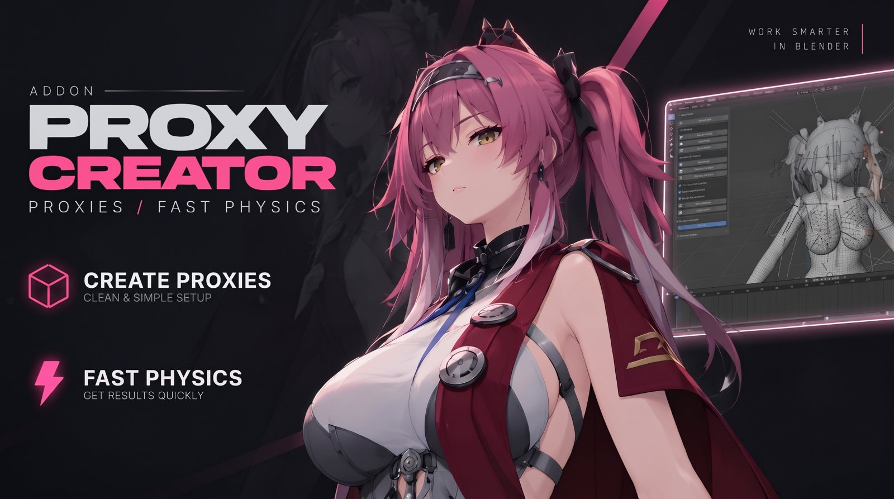
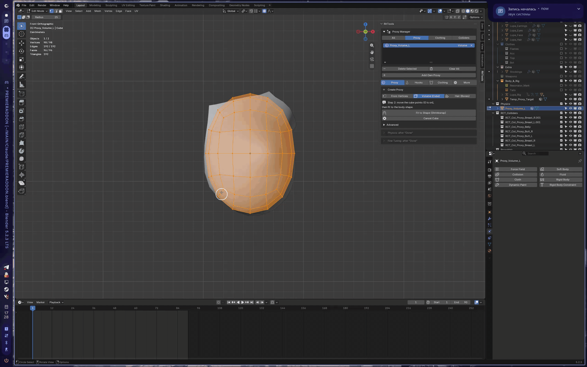

<h1 align="center">RitTools Free</h1>

Blender add-on: low-poly proxies and Cloth physics for soft body parts — in a few clicks. 
Аддон для Blender: лоуполи-прокси и физика Cloth для мягких частей тела — в несколько кликов.

<a href="https://github.com/cromrit/RitTools/releases/latest"><b>⬇ Download / Скачать</b></a> ·
<a href="https://app.lava.top/ritcrom?sort=archive">PRO version</a> ·
<a href="https://discord.gg/2WrpvUDMrC">Discord</a>

---

## English

RitTools builds a low-poly proxy from the body, binds it to the skeleton and adds Cloth physics.
The body follows the proxy through Surface Deform, so the simulation stays fast and stable even on heavy models.

### What the Free version can do
- **Proxy from a cube** — fit a cube to the area, press *Done*, get a clean proxy.
- **Mirror** — make the second side in one click.
- **All physics** — ready presets, quick settings (weight, stiffness, inflation, quality), *Advanced* settings,
  *Support from below*, *Jerk guard*, *Make the other side the same*.
- **Fine tuning** with automatic checks and one-click fixes.
- **Proxy manager** — list, select, remove.
- **Animation baking** (basic quality).
- **Save report** — if something breaks, send the report to Discord.

PRO features (vertex proxies, hooks, hair, collisions from skeleton, Auto-Physics and more) are visible
in the Free interface but greyed out — they are available in the [PRO version](https://app.lava.top/ritcrom?sort=archive).

### Install
1. Download `RitTools_Free_<version>.zip` from [Releases](https://github.com/cromrit/RitTools/releases/latest) (do not unpack).
2. Blender → *Edit → Preferences → Add-ons → Install from Disk…* → choose the zip → enable **RitTools Free**.
3. The panel is in *3D Viewport → Sidebar (N) → RitTools*.

Tested on Blender 5.1 and 5.2.

---

## Русский

RitTools создаёт лоуполи-прокси из тела, привязывает его к скелету и добавляет физику Cloth.
Тело повторяет прокси через Surface Deform, поэтому симуляция быстрая и стабильная даже на тяжёлых моделях.

### Что умеет бесплатная версия
- **Прокси из куба** — подогнать куб под область, нажать «Готово», получить чистый прокси.
- **Зеркало** — вторая сторона в один клик.
- **Вся физика** — готовые пресеты, быстрая настройка (вес, упругость, надутие, качество), «Для опытных»,
  «Опора снизу», «Защита от рывков», «Сделать вторую сторону такой же».
- **Тонкая настройка** с автопроверкой и исправлением в один клик.
- **Менеджер прокси** — список, выбор, удаление.
- **Запекание анимации** (базовое качество).
- **Сохранить отчёт** — если что-то сломалось, пришлите отчёт в Discord.

Функции PRO (прокси из вершин, хуки, волосы, коллизии из скелета, Auto-Physics и другое) видны в интерфейсе,
но серые — они есть в [PRO-версии](https://app.lava.top/ritcrom?sort=archive).

### Установка
1. Скачайте `RitTools_Free_<версия>.zip` в [Releases](https://github.com/cromrit/RitTools/releases/latest) (не распаковывать).
2. Blender → *Edit → Preferences → Add-ons → Install from Disk…* → выберите zip → включите **RitTools Free**.
3. Панель: *3D Viewport → боковая панель (N) → RitTools*.

Проверено на Blender 5.1 и 5.2.

---

## License / Лицензия
- Code (`*.py`): [GPL-3.0-or-later](LICENSE) © 2026 RitCrom.
- Assets (`PROXY.blend`, `PROXYHANDS.obj`, the RitTools name and logo): [ASSETS_LICENSE.txt](ASSETS_LICENSE.txt) —
  results may be used commercially; the files themselves may not be resold or redistributed.
  Результат можно использовать в коммерции; сами файлы перепродавать и раздавать нельзя.

Questions, bugs, ideas → [Discord](https://discord.gg/2WrpvUDMrC).
